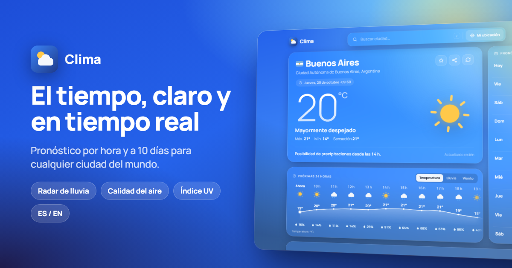

# Clima 🌤️

[](https://github.com/HugoEseverri/weatherAngular/actions/workflows/ci.yml)


Aplicación del tiempo construida con **Angular 22**, con una interfaz moderna, rápida y accesible. Muestra condiciones actuales, pronóstico por hora y a 10 días, radar de lluvia, calidad del aire y más, para cualquier ciudad del mundo.

**🔗 Demo:** [appclimahe.vercel.app](https://appclimahe.vercel.app)



## Características ✨

**Pronóstico**
- 🌡️ Condiciones actuales con un resumen en lenguaje natural ("Posibilidad de precipitaciones desde las 14 h").
- ⏱️ Próximas 24 horas con gráficos de **temperatura, lluvia (mm) y viento**.
- 📅 Pronóstico de **10 días** con barras de rango de temperatura y detalle expandible por día.
- 🗺️ **Radar de precipitaciones animado** de las últimas 2 horas.
- 🍃 Calidad del aire (índice europeo y contaminantes), índice UV, viento con brújula, recorrido del sol, **fase lunar**, humedad, presión, visibilidad y nubosidad.

**Experiencia**
- 🔍 Búsqueda con autocompletado, navegable con teclado (`/` o `Ctrl+K`).
- 📍 Geolocalización, ⭐ favoritos con **comparador de ciudades** y búsquedas recientes.
- 🔗 **Cada ciudad tiene su URL** (`/clima/olavarria-3842670`), lista para compartir con vista previa del clima.
- 🌐 Interfaz en **español e inglés** (detecta el idioma del navegador) y °C / °F al instante.
- 🎨 Fondo animado que cambia según el clima y el momento del día, con íconos SVG propios.
- 📲 **PWA instalable** que funciona sin conexión mostrando el último pronóstico.
- ♿ Accesible: navegación por teclado, roles ARIA y respeto por `prefers-reduced-motion`.

## Rendimiento y calidad 🚀

| Lighthouse (móvil) | Rendimiento | Accesibilidad | Buenas prácticas | SEO |
| ------------------ | :---------: | :-----------: | :--------------: | :-: |
| Puntaje            |     94      |      100      |       100        | 100 |

- **SSR con datos reales**: cada ciudad llega renderizada desde el servidor, ideal para buscadores y para las vistas previas al compartir. El cliente reutiliza esos datos sin volver a pedirlos.
- **Hidratación incremental**: las secciones bajo el pliegue descargan su JavaScript recién al llegar a la pantalla. El mapa (Leaflet) se carga en diferido.
- **Caché en tres niveles**: CDN de Vercel (10 min), memoria del servidor para las APIs y service worker en el navegador.
- **Zoneless** y signals en toda la app: sin zone.js y con detección de cambios mínima.

## Tecnologías 🛠️

- **Angular 22**: componentes standalone, signals, control flow (`@if`, `@for`, `@defer`), zoneless, SSR e hidratación incremental.
- **TypeScript** estricto, **SCSS** y **RxJS**.
- **Open-Meteo** (pronóstico, calidad del aire y geocodificación) y **RainViewer** (radar): APIs gratuitas **sin API key**.
- **Leaflet** para el mapa · **@angular/service-worker** para la PWA.
- **Vitest** (unitarios) · **Playwright** (end-to-end) · **GitHub Actions** (CI).

## Estructura 📁

```
src/app
├── core
│   ├── i18n         # Diccionarios ES/EN y servicio de traducción con signals
│   ├── models       # Tipos del dominio (WeatherReport, Place, …)
│   ├── services     # APIs, store con signals, preferencias, unidades y caché SSR
│   └── utils        # Códigos WMO, fechas por zona horaria, fase lunar, slugs de URL
├── features         # Página del clima, buscador, actual, por hora, 10 días,
│                    # detalles, radar, comparador y fondo animado
├── shared           # Íconos de interfaz, íconos del clima y banderas
└── testing          # Datos de prueba
e2e/                 # Tests de Playwright con APIs simuladas
```

## Cómo ejecutarlo 💻

```bash
npm install
npm start            # desarrollo en http://localhost:4200
npm test             # tests unitarios (Vitest)
npm run e2e          # tests end-to-end (Playwright)
npm run build        # build de producción con SSR
npm run serve:ssr    # sirve el build de producción en http://localhost:4000
```

No hace falta configurar ninguna clave de API.

## Créditos

Datos meteorológicos de [Open-Meteo](https://open-meteo.com/) · Radar de [RainViewer](https://www.rainviewer.com/) · Mapa base de Esri · Banderas de [flagcdn](https://flagcdn.com/).

## Licencia 📄

Este proyecto está bajo la licencia **MIT**.
